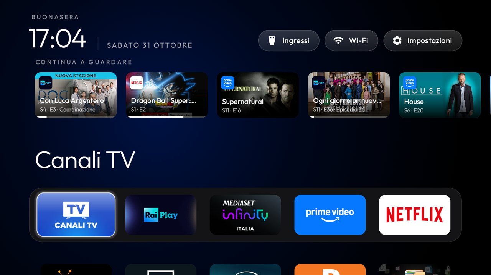

# ferrets6/cleanyourtv: Continue watching with real posters

A fork of [Gathin23/cleanyourtv](https://github.com/Gathin23/cleanyourtv) whose launcher adds one thing: a
**Continue watching** row between the clock and the dock, read from Android TV's own Watch Next table, with the
apps' real posters. Everything else is the upstream launcher, unchanged.

**Built and tested on:** TCL 55C655 (`G10_4K_GB`, Google TV 12, `STT2.230203.001 AS16`), with launcherx disabled.
RaiPlay, Netflix and Prime Video published rows there; Mediaset Infinity and Disney+ publish none.

## Credits

- **[gwiersma](https://github.com/gwiersma)** wrote the row itself: `ContinueWatching.java`, `ContinueRow.java`,
  its focus handling and the `continue_watching` switch, in
  [gwiersma/cleanyourtv](https://github.com/gwiersma/cleanyourtv/blob/main/FORK.md). That commit
  (`launcher: Continue watching row from the system's Watch Next table`) is cherry-picked here unchanged, with its
  author. Thank you: this fork is mostly your work.
- **[SferaDev](https://github.com/SferaDev)** wrote [`docs/watch-next.md`](docs/watch-next.md), how a launcher
  reads the table, and showed with a [Google TV style home](https://github.com/SferaDev/android-tv/tree/dev) how
  good the row looks with real posters, which is the idea behind the second commit. Thank you.

## What it changes on top of gwiersma's row

- **Real posters.** RaiPlay, Netflix and Prime Video publish only `https://` posters, which the upstream launcher
  cannot fetch, so the row showed app banners. Posters now download in the background, one at a time, capped at
  4 MB each; a card keeps the app's banner until its poster arrives, and for good if it fails.
- **Newest first, per show.** One card per show used to be picked in table order, which kept a show's *oldest*
  row: a daily RaiPlay series showed an episode from 50 days ago and fell out of date order. Rows now sort by last
  engagement first, and each show keeps its newest row.
- **Which app.** Each card shows the publishing app's icon in its top corner, as Google TV does.
- **Italian**, and the row title in the greeting's style.

## The price

This build adds the **`INTERNET`** permission, for the posters only, which is why it lives in a fork: the upstream
launcher promises no network access at all. It also needs `READ_TV_LISTINGS`, which `launcher/build-and-install.sh`
grants (`pm grant`); the PowerShell script does not, so on Windows run
`pm grant com.gathin.tvhome android.permission.READ_TV_LISTINGS` after installing.

## Building

As upstream, with `continue_watching` set to `true` in `launcher/app/src/main/res/values/config.xml`:
`TV_HOST=<tv ip> launcher/build-and-install.sh`.
